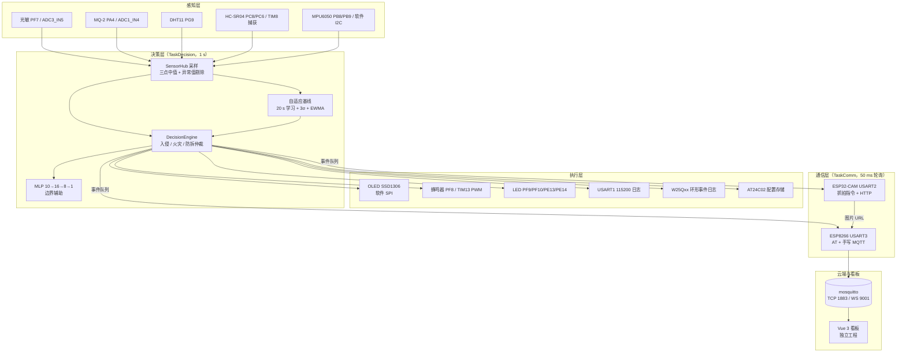

# SmartGuard · 智能空间守护系统

> **STM32F407ZE + FreeRTOS V10.5.1** 的多传感器空间守护系统：端侧学习环境基线，本地完成入侵 / 火灾 / 防拆判定，ESP32-CAM 抓拍取证，手写 MQTT 上云，Vue 3 看板远程监控。

**一句话**：设备自己学出"这个房间正常是什么样"，只在统计显著偏离时告警；网络只负责通知，断网不影响本地决策与记录。

| 项 | 内容 |
|---|---|
| 主控 | STM32F407ZE（Cortex-M4F，168 MHz，192 KB RAM，1 MB Flash） |
| 实时内核 | FreeRTOS V10.5.1（RVDS/ARM_CM4F port，heap_4，1 kHz tick） |
| 构建 | Keil MDK 5 + ARMCC V5 + ST 标准外设库 + J-Link |
| 通信 | ESP8266（AT + 手写 MQTT 3.1.1）、ESP32-CAM（串口指令 + HTTP） |
| 上位机 | Vue 3 + Vite + Pinia + ECharts + mqtt.js（独立工程，见 [Web 看板](#web-看板)） |
| 代码规模 | 5 个 FreeRTOS 任务 + 20 余个外设驱动模块（详见 [docs/architecture.md](docs/architecture.md)） |

---

## 招聘方速览：这个项目体现了哪些嵌入式能力

| 能力 | 对应实现 | 证据位置 |
|---|---|---|
| RTOS 多任务设计 | 5 个任务按 4/3/2/2/1 优先级抢占调度；队列传递告警/模式事件；I2C 与 OLED 总线互斥 | [docs/freertos-tasks.md](docs/freertos-tasks.md) |
| 外设驱动开发 | GPIO / ADC / USART / TIM 输入捕获 / TIM PWM / 软件 I2C / 软件 SPI / IWDG / RTC / 内部 Flash | `Hardware/` 一模块一目录，[docs/hardware.md](docs/hardware.md) |
| 通信协议实现 | 不依赖 MQTT SDK，在 AT 透传上手拼 CONNECT / SUBSCRIBE / PUBLISH / PINGREQ 报文 | `Hardware/ESP8266/esp8266.c` |
| 数据处理与滤波 | 三点中值、σ 自适应阈值、EWMA 慢跟随、迟滞 + 连续确认、防基线污染、滑动窗口投票 | [docs/data-flow.md](docs/data-flow.md) |
| 状态机与事件驱动 | HOME / AWAY / SLEEP 模式机、告警优先级仲裁、布防静息采样子状态、事件队列 | [docs/state-machine.md](docs/state-machine.md) |
| 可靠性设计 | IWDG 2 s、配置 magic+CRC32、W25Qxx 环形日志黑匣子、断网热自愈、长阻塞分段喂狗 | [docs/architecture.md](docs/architecture.md#可靠性设计) |
| 端侧机器学习 | sklearn 训练的 MLP（10→16→8→1）导出为 C 头文件，边界场景辅助二分类 | `Hardware/ML/`、`v1_train/` |
| 文档与验证 | 硬件核对清单、演示脚本、测试报告、构建烧录说明 | [docs/](docs/) |

---

## 项目背景

常见的门禁 / 烟雾报警器有三个通病：

1. **阈值写死**——换一个房间、换一个安装位置就要重新调参；
2. **误报多**——一片阴影、一次温度漂移就可能触发；
3. **断网即失效**——决策依赖云端，网络一断就只剩一个不会响的盒子。

SmartGuard 的验证目标是：**把决策权和可靠性都留在端侧**。上电后先学习 20 秒环境基线，运行期用 EWMA 缓慢跟踪环境变化，只在统计显著偏离时告警；告警事件写入 SPI Flash 黑匣子，网络只承担通知与远程查看。

第二个目标是工程训练：手写 MQTT 3.1.1 报文、手写 EEPROM / SPI Flash 存储层、把 FreeRTOS 迁移做到"驱动与业务逻辑尽量不改"，并保留 `USE_FREERTOS=0` 一键回退到裸机协作式调度的能力。

---

## 系统架构



分层职责与模块清单见 [docs/architecture.md](docs/architecture.md)。

---

## 硬件平台

| 模块 | 接口 / 引脚 | 作用 |
|---|---|---|
| SSD1306 0.96" OLED | 软件 SPI：SCLK PB0 / DC PB1 / MOSI PF11 / CS PC13 | 本地面板（主页 / 告警页 / 学习进度） |
| DHT11 | PG9 单总线，2 s 节流 | 温度、湿度 |
| MQ-2 烟雾 | PA4 / ADC1_IN4 | 烟雾浓度（火灾判据） |
| 光敏电阻 | PF7 / ADC3_IN5 | 环境光（自动照明） |
| HC-SR04 | TRIG PC8 / ECHO PC6 / TIM8 输入捕获 | 距离（入侵判据） |
| MPU6050 | PB8 / PB9 软件 I2C（0x68） | 防拆 / 震动 |
| AT24C02 | PB8 / PB9 软件 I2C（0x50） | 基线与模式掉电存储 |
| W25Qxx SPI Flash | CS PB14 / SCK PB3 / MISO PB4 / MOSI PB5 | 告警事件环形日志（16 KB / 1024 条） |
| ESP8266 | USART3 PB10 / PB11，115200 | WiFi + MQTT |
| ESP32-CAM | USART2 PA2 / PA3，115200，独立 5 V 供电 | 入侵抓拍 + HTTP 图片 |
| 板载按键 S1~S4 | PA0 / PE2 / PE3 / PE4（低电平有效） | 模式切换 / 手动告警 / 重学基线 |
| 无源蜂鸣器 | PF8 / TIM13_CH1 PWM | 分级告警音（`BEEP_ENABLE` 可整体关闭） |
| 板载 LED | PF9 / PF10 / PE13 / PE14 | 告警与状态指示 |

> 详细接线、模块选型与排错流程见 [docs/hardware.md](docs/hardware.md) 和 [docs/HARDWARE_CHECKLIST.md](docs/HARDWARE_CHECKLIST.md)。
>
> **注意**：PB3 / PB4 同时是 JTDO / JTRST，调试器必须工作在 SWD 模式；PC13 同时被 RTC Tamper 与 OLED_CS 使用，RTC 初始化时必须禁用 Tamper。

---

## 软件环境与核心技术栈

| 类别 | 选型 |
|---|---|
| IDE / 编译器 | Keil MDK 5，ARMCC V5（AC5） |
| HAL / 库 | STM32F4xx 标准外设库（未使用 HAL / CubeMX 生成代码） |
| RTOS | FreeRTOS V10.5.1，`portable/RVDS/ARM_CM4F`，`heap_4` |
| 端侧 ML | Python + scikit-learn 训练，导出静态 C 数组（`ml_inference.h`） |
| 网络 | ESP8266 AT 指令，TCP 1883；手写 MQTT 3.1.1（QoS 0） |
| 调试 | J-Link SWD，USART1 115200 日志 |
| 上位机 | Vue 3 + Vite + Pinia + Vue Router + ECharts + mqtt.js |

---

## FreeRTOS 多任务设计

| 任务 | 优先级 | 栈（word） | 周期 | 职责 |
|---|---|---|---|---|
| `TaskFast` | 4 | 512 | 50 ms | 按键扫描 + IWDG 喂狗 |
| `TaskTamper` | 3 | 320 | 200 ms | MPU6050 防拆采样（5 Hz） |
| `TaskDecision` | 2 | 640 | 1000 ms | 传感器采样、决策、告警本地执行 |
| `TaskComm` | 2 | 1024 | 50 ms 轮询 | MQTT 收包、遥测 / 心跳 / 健康检查、告警上报、CAM 抓拍 |
| `TaskDisplay` | 1 | 640 | 500 ms | RTC、OLED 刷新、配置落盘 |

任务间通信：

- **事件队列** `s_comm_queue`（深度 8，元素 2 字节）：`EVT_KEY_MODE` / `EVT_ALERT`，由按键任务和决策任务投递，通信任务消费；
- **I2C 互斥锁** `s_i2c_mutex`：AT24C02 与 MPU6050 共用 PB8/PB9；
- **OLED 互斥锁** `s_oled_mutex`：显示任务与按键即时重绘共用软件 SPI。

设计要点：

- 所有 ESP8266 / ESP32-CAM 串口访问收敛到 `TaskComm` 单任务，避免抢占调度下两个任务同时操作 USART；
- USART1/2/3 中断服务程序只填充环形缓冲，**不调用任何 FreeRTOS API**；NVIC 分组为 `NVIC_PriorityGroup_4`；
- `vApplicationIdleHook()` 执行 `__WFI()`，保留低功耗空闲行为；
- 栈溢出与堆分配失败钩子只置故障标记并停机，便于 J-Link 附加后定位。

完整时序、优先级与回退方案见 [docs/freertos-tasks.md](docs/freertos-tasks.md)。

---

## 传感器数据处理与滤波

| 处理 | 实现 |
|---|---|
| 距离 / 光照毛刺抑制 | 每周期各采 3 次取中值；距离 < 2 cm 或 > 400 cm 视为无效并剔除 |
| DHT11 节流 | 决策周期 1 s，DHT11 按调用次数二分频为 2 s；读取失败保留上次有效值 |
| 基线学习 | 上电阻塞采样 20 次，计算均值与标准差，得到初始阈值 `mq2_fire_threshold = max(mean + 3σ, 400)` |
| EWMA 慢跟随 | α = 0.01；光照用 2α 以适应昼夜变化 |
| 防基线污染 | MQ-2 偏离超过 2σ、温湿度偏离超过 3σ 时不吸收，避免真实异常被学进基线 |
| 火灾判定 | 烟雾 ≥ 阈值 + 60 迟滞带，且温度高于基线或 ≥ 40 °C，连续 4 个样本成立才告警 |
| 入侵判定 | 进入 AWAY 后先采 10 个距离样本取中位数作为静息距离；比静息距离近 > 15 cm 才判逼近；距离 ≤ 8 cm 当周期直通告警；其余需连续 2 次命中 |
| 防拆判定 | MPU6050 高频采样 + 8 格滑动窗口，命中 ≥ 3 次触发；HOME 模式主动抑制 |
| 边界辅助 | 距离 < 120 cm 且规则未命中时，MLP 用光照 / 距离 / 温湿度及基线偏差做二分类 |

> 具体公式、阈值来源与参数位置见 [docs/data-flow.md](docs/data-flow.md)。

---

## 状态机与事件驱动

三种守护模式：

| 模式 | 入侵检测 | 防拆检测 | 自动照明 | 火灾检测 |
|---|---|---|---|---|
| HOME | 关闭 | 关闭 | 开启 | 开启 |
| AWAY | 开启（10 s 布防静息采样） | 开启 | 开启 | 开启 |
| SLEEP | 关闭 | 开启 | 关闭 | 开启 |

告警仲裁优先级为 **火灾 > 防拆 > 入侵**，同类告警 5 s 内不重复上报；本地蜂鸣器、LED、OLED 告警页与事件日志只在告警状态翻转时触发。

状态定义、迁移条件与事件流见 [docs/state-machine.md](docs/state-machine.md)。

---

## 通信链路与数据流

### ESP8266 + 手写 MQTT

固件通过 USART3 以 AT 指令连接 WiFi，再建立 TCP 连接；MQTT 报文由 `esp8266.c` 手工组包，未使用任何 MQTT SDK。

| Topic | 方向 | 载荷 | QoS / retain |
|---|---|---|---|
| `home/sensor/status` | 上行 | 遥测 `T=..,H=..,D=..,L=..,M=..`；告警 `ALERT:Intrusion!` / `ALERT:Fire!` / `ALERT:Tamper!` / `ALERT:EnvAbnormal!` | QoS 0 / 否 |
| `home/light/status` | 上行 | `on` / `off` | QoS 0 / **retain** |
| `home/mode/status` | 上行 | `HOME` / `AWAY` / `SLEEP` | QoS 0 / **retain** |
| `home/cam/shot` | 上行 | 抓拍图片 URL | QoS 0 / **retain** |
| `home/light/cmd` | 下行 | `on` / `off` / `HOME` / `AWAY` / `SLEEP` / `CAPTURE` / `ALARM` | QoS 0 / 否 |

- 遥测 10 s 一条，心跳按 keepalive / 2（30 s）发送；
- 下行命令做了 500 ms 合并上报与 `CAPTURE` 5 s 硬限速，防止命令洪峰挤掉 `SEND OK` 窗口；
- 断网恢复为分级自愈：MQTT 重连退避 → WiFi 重关联 → 模块软复位，全部在通信任务内完成，不重启系统。

### ESP32-CAM

- STM32 通过 USART2 发送 `STATUS` / `CAPTURE` / `LED ON|OFF`；
- CAM 返回 `OK http://<ip>/shot.jpg`，固件把 URL 以 retain 方式发布到 `home/cam/shot`；
- 入侵告警时自动抓拍；Web 端可手动抓拍与查看 12 张历史环；
- CAM 侧提供 `/snapshot` 与 `/stream` HTTP 端点，MJPEG 实时流为单客户端。

### Web 看板

Vue 3 看板通过 MQTT over WebSocket（`ws://<broker>:9001`）订阅上述主题，展示实时数据、告警时间线、距离曲线、CAM 抓拍与远程控制。**该工程独立于本仓库**，位于工作区的同级目录 `smartguard-web/`，不在本仓库跟踪范围内；其技术栈与页面说明见该工程自己的 README。

完整数据流（采样 → 决策 → 队列 → MQTT → 看板）见 [docs/data-flow.md](docs/data-flow.md)。

---

## 目录结构

```
SmartGuard/
├── Core/            启动文件 startup_stm32f40_41xxx.s + Cortex-M4 内核头
├── Library/         STM32F4xx 标准外设库
├── FreeRTOS/        FreeRTOS V10.5.1 内核 + ARM_CM4F port + FreeRTOSConfig.h
├── Hardware/        驱动层，一模块一目录
│   ├── APP/         sensor_hub / adaptive_threshold / decision_engine
│   │                event_log / scheduler（裸机协作式调度，USE_FREERTOS=0 时启用）
│   ├── ML/          sklearn 导出的 MLP 权重头
│   ├── CONFIG_STORE 配置掉电存储（AT24C02 / 内部 Flash 双后端）
│   └── ADC AT24C02 BEEP DELAY DHT11 ESP32_CAM ESP8266 HCSR04
│      IIC KEY LED MPU6050 OLED PWM RTC USART W25QXX WDG
├── User/            main.c、中断向量、Keil 工程 Template.uvprojx
├── v1_train/        数据采集 + sklearn 训练 + 权重头生成
├── tools/           OLED 字库生成、UDP 接收等辅助脚本
├── docs/            架构 / FreeRTOS / 状态机 / 数据流 / 硬件 / 构建 / 测试文档
│   └── logs/        历史串口验证日志（本地保留，不入库）
└── Object/          编译产物（已 gitignore）
```

---

## 编译与烧录

### 环境

- Keil MDK 5（ARMCC V5）
- J-Link 驱动与 SWD 接线
- 串口工具（USART1 115200）

### 命令行全量编译

```bash
UV4.exe -r User/Template.uvprojx -j0 -o build_log.txt
```

期望结果：

```
"..\Object\Template.axf" - 0 Error(s), 0 Warning(s).
```

当前工作区最近一次全量构建（2026-10-22，含 FreeRTOS 与蜂鸣器启用）：

```
Program Size: Code=51568 RO-data=6504 RW-data=372 ZI-data=55692
0 Error(s), 0 Warning(s)
```

### 烧录与运行

1. J-Link 连接 SWD（SWDIO / SWCLK / GND / 3V3）；
2. Keil 内下载，或 `UV4.exe -f User/Template.uvprojx`；
3. 串口 115200 打开 USART1，上电后应看到启动横幅与基线学习 / 恢复日志。

### 关键配置宏

| 宏 | 位置 | 说明 |
|---|---|---|
| `USE_FREERTOS` | `User/Template.uvprojx` 预处理符号 | `1`=FreeRTOS 抢占调度，`0`=裸机协作式调度 |
| `USE_OLED` / `USE_ESP8266` / `USE_DHT11` / `USE_ML` / `USE_RTC` | `Hardware/APP/decision_engine.h` | 模块级开关 |
| `USE_MQ2` | `Hardware/ADC/adc.h` | 烟雾通道开关 |
| `USE_ESP32_CAM` | `Hardware/ESP32_CAM/esp32_cam.h` | CAM 联动开关 |
| `BEEP_ENABLE` | `Hardware/BEEP/beep.h` | 蜂鸣器总开关 |

> WiFi 与巴法云凭据外置在 `Hardware/ESP8266/wifi_config.h`、`bemfa_config.h`，这两个文件已被 `.gitignore` 排除。首次编译前需从同目录的 `.example` 模板复制并填写。

完整的构建环境、参数与常见问题见 [docs/build-and-flash.md](docs/build-and-flash.md)。

---

## 运行方法

1. 准备 2.4 GHz 热点，把 SSID / 密码填入 `wifi_config.h`；
2. 启动本地 mosquitto：`listener 1883` 供固件 TCP 连接，`listener 9001 protocol websockets` 供 Web 看板连接；
3. 烧录后上电，等待基线学习完成（或从 EEPROM 恢复）；
4. 用 `mosquitto_sub -h <broker> -t 'home/#' -v` 观察遥测与告警；
5. 按 S1 / S2 / S3 切换 HOME / AWAY / SLEEP；S4 短按触发一次手动告警测试，长按 1.5 s 回放事件日志；S3 长按 2 s 重新学习 20 s 基线。

---

## 测试与验证

| 范围 | 结果 | 记录 |
|---|---|---|
| 全量编译 | 2026-10-22：0 Error / 0 Warning | `Object/Template.build_log.htm` |
| 启动自检 | 横幅、硬件初始化、基线学习 / EEPROM 恢复、进入主循环 | [docs/test-report.md](docs/test-report.md) |
| MQTT 上下行 | 遥测、灯控、模式同步、告警上报、retain 状态回读 | [docs/p0_test_log.md](docs/p0_test_log.md) |
| 告警链路 | 入侵 / 火灾 / 防拆判定与本地声光、事件落盘 | [docs/test-report.md](docs/test-report.md) |
| 掉电恢复 | 配置 magic+CRC32 校验、事件日志写指针恢复 | [docs/test-report.md](docs/test-report.md) |
| 断网恢复 | MQTT 重连、WiFi 重关联、模块软复位分级自愈 | [docs/test-report.md](docs/test-report.md) |

> 测试结论按"已实测 / 仅静态检查 / 未验证"分级标注，详见 [docs/test-report.md](docs/test-report.md)。

---

## 已知限制与未验证项

1. **火灾温度判据退化**：本板 DHT11 实测长期恒定（26.0 °C / 41 %），温度 σ = 0，温度关实际不起作用，火灾检测实质为烟雾单判据。
2. **火灾检测不受模式门控**：任何模式下 MQ-2 越限都会告警，属于安全保守设计，但不是模式设计意图。
3. **ESP32-CAM 单客户端**：`/stream` 同一时刻只服务一个连接，第二个连接最长排队 300 s；`/snapshot` 无鉴权、无节流（待办）。
4. **`CAPTURE` 阻塞**：CAM 离线时一次抓拍最坏阻塞通信任务约 4 s（1 s 探测 + 3 s 等待），已用 5 s 硬限速兜底，尚未改为非阻塞状态机。
5. **MQTT 断网恢复时间不固定**：受健康检查周期与失败计数影响，实测约 30 s ~ 数分钟；不是固定退避值。
6. **broker 不在仓库内**：需要自行安装并配置 mosquitto（1883 TCP + 9001 WebSocket），仓库不提供启动脚本。
7. **开机模式短暂显示**：上电默认 AWAY，若 EEPROM 保存的是 HOME / SLEEP，启动早期可能先显示 AWAY 再纠正，最终状态正确。
8. **远程切换的模式不落盘**：只有板载按键切换会写 EEPROM；通过 MQTT 切换的模式掉电后回到最后一次按键保存的值。
9. **ML 日志字符串与实现不一致**：启动打印为 `10->16->1`，实际网络结构为 10→16→8→1（仅日志文本问题）。
10. **凭据历史**：早期提交曾包含明文 WiFi / 巴法云凭据，当前文件已外置并轮换；Git 历史未重写。
11. **未验证项**：长时间（> 24 h）连续运行、极端网络抖动、多浏览器并发命令洪峰下的最终一致性、CAM 断线后的长时间自愈，均未做正式回归。

---

## 文档索引

| 文档 | 内容 |
|---|---|
| [docs/architecture.md](docs/architecture.md) | 分层架构、模块清单、启动流程、可靠性设计 |
| [docs/freertos-tasks.md](docs/freertos-tasks.md) | 任务职责、优先级、栈、IPC、调度与回退方案 |
| [docs/state-machine.md](docs/state-machine.md) | 模式状态机、告警仲裁、布防子状态 |
| [docs/data-flow.md](docs/data-flow.md) | 采样 → 决策 → 告警 → 上云的完整数据流 |
| [docs/hardware.md](docs/hardware.md) | 硬件组成、引脚、总线与供电注意 |
| [docs/build-and-flash.md](docs/build-and-flash.md) | 构建环境、编译、烧录、配置宏 |
| [docs/test-report.md](docs/test-report.md) | 测试条件、结果、未验证项 |
| [docs/HARDWARE_CHECKLIST.md](docs/HARDWARE_CHECKLIST.md) | 硬件核对与排错清单（详细版） |
| [docs/DESIGN_PRESENTATION.md](docs/DESIGN_PRESENTATION.md) | 设计说明与答辩讲解要点 |
| [docs/DEMO_SCRIPT.md](docs/DEMO_SCRIPT.md) | 6 分钟演示脚本与问答 |
| [docs/PCB_DESIGN_REQUIREMENTS.md](docs/PCB_DESIGN_REQUIREMENTS.md) | PCB 设计需求规格书 |

---

## 版本记录

| 阶段 | 内容 |
|---|---|
| v0.4 | 裸机采集 + 自适应阈值 + 多传感器融合 + USART1 日志 |
| v0.5~v0.6 | MQTT 双向通信、防拆检测、OLED 主界面、Web 看板 |
| v0.7 | 协作式调度器、四层存储、入侵抓拍全链路、可靠性加固 |
| v0.7.1 | SLEEP 语义补全、备份 SRAM 写指针、分级告警音、S4 消抖 |
| v0.7.2 | 按键极性修正、W25Qxx 写保护自愈、CAM 历史环、远程 CAPTURE / ALARM |
| 当前工作区 | FreeRTOS V10.5.1 多任务迁移：任务拆分、事件队列、I2C / OLED 互斥、中断约束、裸机回退开关 |

---

## 许可证与第三方组件

本项目为个人 / 课程项目，**暂未指定正式开源许可证**。仓库包含以下第三方组件，使用时请遵守其各自许可：

- FreeRTOS Kernel：MIT（见 [FreeRTOS/LICENSE.md](FreeRTOS/LICENSE.md)）；
- STM32F4xx 标准外设库：STMicroelectronics 许可；
- SSD1306、MPU6050 等驱动参考公开教学例程后重写。

如需将本项目代码用于商业用途，请先确认上述组件的许可条款。
