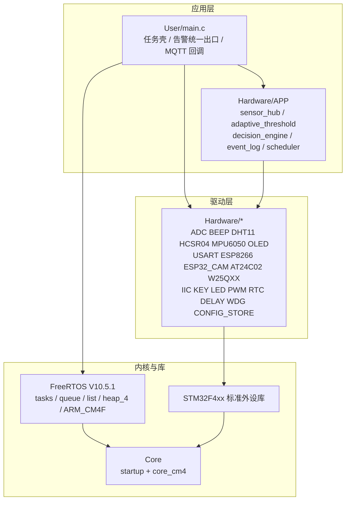
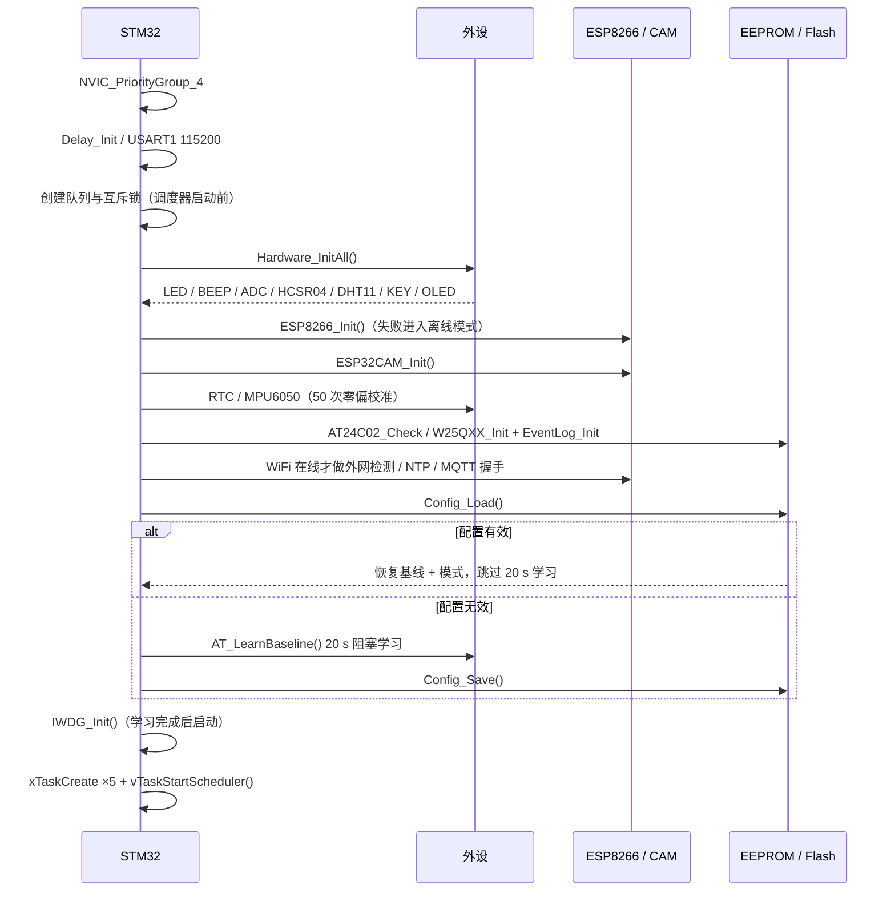

# 系统架构

> 适用代码：当前工作区 `SmartGuard/`（STM32F407ZE + FreeRTOS V10.5.1）。
> 本文描述**实际实现**；设计目标、历史演进与答辩讲解见 [DESIGN_PRESENTATION.md](DESIGN_PRESENTATION.md)。

---

## 1. 设计目标与约束

| 目标 | 实现约束 |
|---|---|
| 端侧决策 | 入侵 / 火灾 / 防拆判定全部在 STM32 完成，网络只负责通知 |
| 低误报 | 自适应基线 + 统计阈值 + 连续确认 + 迟滞 + 布防静息基准 |
| 断网可用 | 本地声光、事件日志不依赖网络；网络恢复自动重连 |
| 掉电可恢复 | 配置存 AT24C02（magic + CRC32），事件存 W25Qxx 环形日志 |
| 可回退 | `USE_FREERTOS=1` 使用 FreeRTOS；置 0 回到裸机协作式调度器 |

---

## 2. 分层结构



**分层原则**

- `Hardware/<模块>/` 一模块一目录，驱动只暴露 `Xxx_Init()` / 读写接口，不直接依赖业务状态；
- `Hardware/APP/` 放跨模块的应用逻辑：采样聚合、阈值学习、决策仲裁、事件日志；
- `User/main.c` 是唯一的业务编排点：初始化顺序、任务壳、告警统一出口、MQTT 下行回调；
- FreeRTOS 只在 `main.c` 的任务层与同步对象中出现，驱动层不直接调用 RTOS API（中断服务程序亦不调用）。

---

## 3. 模块清单

### 3.1 应用模块（`Hardware/APP/`）

| 文件 | 职责 | 关键接口 |
|---|---|---|
| `sensor_hub.c/.h` | 统一聚合光敏、MQ-2、DHT11、HC-SR04 为 `Sensor_Data_t` | `SensorHub_Init()` / `SensorHub_Update()` / `SensorHub_GetData()` |
| `adaptive_threshold.c/.h` | 20 s 基线学习、σ 阈值、EWMA 慢跟随、火灾判定 | `AT_LearnBaseline()` / `AT_Update()` / `AT_CheckFire()` |
| `decision_engine.c/.h` | 模式状态机、入侵 / 火灾 / 防拆仲裁、本地声光 | `DecisionEngine_Run()` / `DecisionEngine_SetMode()` |
| `event_log.c/.h` | W25Qxx 16 B 定长记录、4 扇区环形日志、写指针恢复 | `EventLog_Init()` / `EventLog_Add()` / `EventLog_Dump()` |
| `scheduler.c/.h` | 裸机协作式周期调度（`USE_FREERTOS=0` 时启用） | `scheduler_init()` / `scheduler_register_table()` / `scheduler_run()` |

### 3.2 驱动模块（`Hardware/`）

| 目录 | 外设 / 接口 | 说明 |
|---|---|---|
| `ADC` | ADC1_IN4（PA4）、ADC3_IN5（PF7） | MQ-2 与光敏；软件触发单次转换 |
| `BEEP` | TIM13_CH1 PWM（PF8） | 无源蜂鸣器，分级告警音；`BEEP_ENABLE` 可整体关闭 |
| `DHT11` | PG9 单总线 | 温湿度，2 s 节流；失败不覆盖上次有效值 |
| `HCSR04` | TIM8 输入捕获（PC8 触发 / PC6 回波） | 距离，超时返回 0 |
| `MPU6050` | PB8/PB9 软件 I2C（0x68） | 防拆 / 震动，启动时 50 次零偏校准 |
| `AT24C02` | PB8/PB9 软件 I2C（0x50） | 256 B EEPROM，8 B 分页写 |
| `W25QXX` | 软件 SPI：CS PB14 / SCK PB3 / MISO PB4 / MOSI PB5 | 事件日志；写保护自愈与写后读回校验 |
| `OLED` | 软件 SPI：SCLK PB0 / DC PB1 / MOSI PF11 / CS PC13 | SSD1306 主页 / 告警页 / 学习进度 |
| `ESP8266` | USART3 PB10/PB11，115200 | AT 指令、手写 MQTT 3.1.1、NTP |
| `ESP32_CAM` | USART2 PA2/PA3，115200 | `STATUS` / `CAPTURE` / `LED` 指令，HTTP URL 回传 |
| `USART` | USART1/2/3 | 日志、CAM、WiFi；RX 环形缓冲 + TX 锁 |
| `KEY` | PA0 / PE2 / PE3 / PE4 | 四键低电平有效，50 ms 消抖 |
| `LED` / `PWM` | PF9 / PF10 / PE13 / PE14 | 告警灯与自动照明（引脚复用见硬件文档） |
| `RTC` | LSE / LSI，VBAT 备份域 | 日历、NTP 对时；PC13 Tamper 必须禁用 |
| `IIC` / `DELAY` / `WDG` | 软件 I2C、SysTick 时基、IWDG | 基础设施 |
| `CONFIG_STORE` | AT24C02（默认）/ 内部 Flash 双后端 | magic + CRC32，56 B 配置结构 |
| `ML` | 无外设 | sklearn 导出的 MLP 权重头 |

---

## 4. 启动流程



**顺序上的关键约束**

1. `NVIC_PriorityGroup_4` 必须在任何中断使能前设置，满足 FreeRTOS 对全部优先级位都用于抢占的要求；
2. 队列与互斥锁在 `vTaskStartScheduler()` 之前创建，使用 `heap_4` 的早期可用性；
3. WiFi 离线时跳过外网检测 / NTP / MQTT 握手，避免多段 AT 超时串行叠加拖慢启动；
4. IWDG 在 20 s 基线学习完成后才启动，避免学习期被看门狗复位；
5. `Config_Load()` 成功后不再重新学习，直接进入主循环。

---

## 5. 资源占用

| 资源 | 配置 |
|---|---|
| FreeRTOS 堆 | `heap_4`，40 KB（`configTOTAL_HEAP_SIZE`） |
| 任务栈合计 | 512 + 320 + 640 + 1024 + 640 = 3136 word ≈ 12.5 KB |
| 中断优先级 | `NVIC_PriorityGroup_4`；USART 抢占优先级 1；`configMAX_SYSCALL_INTERRUPT_PRIORITY = 5` |
| 启动栈 / 堆 | 启动文件默认值（`startup_stm32f40_41xxx.s`） |

最近一次全量构建（2026-10-22，`Object/Template.build_log.htm`）：

```
Program Size: Code=51568 RO-data=6504 RW-data=372 ZI-data=55692
0 Error(s), 0 Warning(s)
```

---

## 6. 可靠性设计

| 机制 | 实现位置 | 行为 |
|---|---|---|
| 独立看门狗 | `Hardware/WDG/iwdg.h` + `main.c` | IWDG 2 s；`TaskFast` 每 50 ms 喂狗；长阻塞循环内分段喂狗 |
| 配置撕裂保护 | `CONFIG_STORE/config_store.c` | magic + 硬件 CRC32；写一半掉电时明确判无效而非读脏数据 |
| 事件黑匣子 | `Hardware/APP/event_log.c` | 16 B 定长记录、4 扇区环形、写后读回校验、备份 SRAM 写指针交叉验证 |
| 存储自愈 | `W25QXX/w25qxx.c` | 开机擦写读回自检；检测并解除 BP / CMP / WPS 写保护 |
| 网络分级自愈 | `ESP8266/esp8266.c` | MQTT 重连退避 → WiFi 重关联 → 模块软复位；全部在通信任务内完成 |
| 命令洪峰防护 | `main.c` + `esp8266.c` | 灯 / 模式上报 500 ms 合并；`CAPTURE` 5 s 硬限速 |
| 中断安全 | `USART/usart.c` + `stm32f4xx_it.c` | ISR 只填环形缓冲，不调用 FreeRTOS API |
| 故障定位 | `main.c` 钩子 | 栈溢出 / 堆失败置 `s_rtos_fault` 并停机，J-Link 可读 |

---

## 7. 裸机回退机制

`User/Template.uvprojx` 的预处理符号定义 `USE_FREERTOS=1`。置 0 后：

- `main.c` 不再包含 `FreeRTOS.h` / `task.h`，改为 `scheduler.h`；
- `task_fast` / `task_tamper` / `task_decision` / `task_display` 等函数作为单次执行体，由 `scheduler.c` 按周期调度；
- 事件队列与互斥锁相关代码被 `#if USE_FREERTOS` 排除；
- 协作式调度器在主循环末尾执行 `__WFI`，周期基于 `g_tick`。

该开关保留了完整的历史实现，便于对比"协作式 vs 抢占式"的差异；两种模式的业务函数体共用，避免双份维护。

---

## 8. 已知架构限制

- `main.c` 仍承担较多编排职责（约 1400 行），业务状态与任务壳耦合度高，后续可拆分为独立模块；
- CAM 抓拍在通信任务内同步等待，最坏阻塞约 4 s，尚未改为非阻塞状态机；
- 事件日志只记录告警状态翻转，不记录遥测历史；
- Web 看板为独立工程，不在本仓库内，仓库本身不包含 broker 配置。
