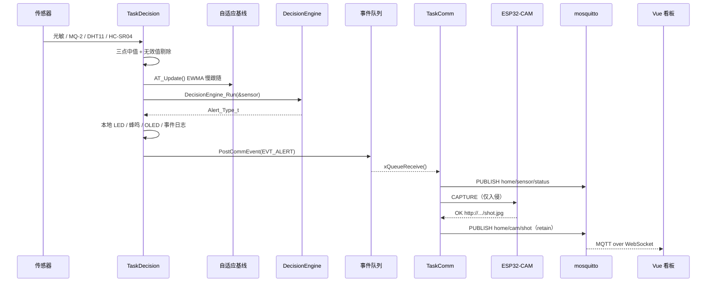
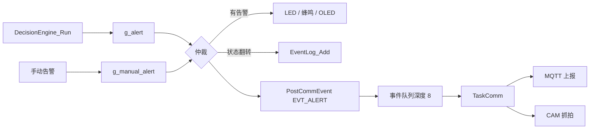
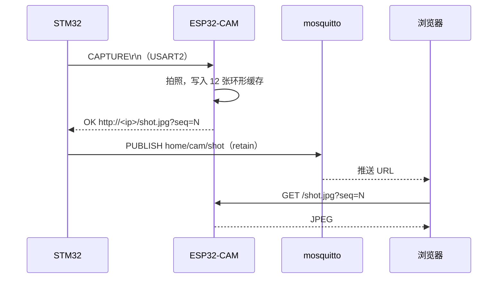

# 数据流

> 从传感器采样到本地告警、云端展示的完整链路。
> 代码位置：`User/main.c`、`Hardware/APP/*`、`Hardware/ESP8266/esp8266.c`、`Hardware/ESP32_CAM/esp32_cam.c`。

---

## 1. 端到端数据流



---

## 2. 采样层

### 2.1 决策周期采样（`SampleAllSensors()`，1 s）

| 传感器 | 采样方式 | 异常处理 |
|---|---|---|
| 光敏（PF7 / ADC3_IN5） | 连续 3 次 ADC，取中值 | 无 |
| HC-SR04（PC8 / PC6） | 连续 3 次测距，间隔 30 ms，取中值 | < 2 cm 或 > 400 cm 置 0；3 次全无效时沿用上次值 |
| DHT11（PG9） | 每 2 次决策周期读一次（2 s） | 读取失败不覆盖上次有效值 |
| MQ-2（PA4 / ADC1_IN4） | 每周期单次 ADC | 返回 0 时火灾判定直接跳过 |

> 3 次测距之间插入 `delay_ms(30)`，满足 HC-SR04 ≥ 60 ms 的测量周期要求。FreeRTOS 下 `delay_ms` 映射为 `vTaskDelay`，只阻塞 `TaskDecision`。

### 2.2 防拆高频采样（`TamperUpdate()`，200 ms）

| 项 | 值 |
|---|---|
| 采样频率 | 5 Hz（`TaskTamper`） |
| 判据 | 陀螺仪任一轴偏离上电零偏 > 8 dps 记 1 次命中 |
| 窗口 | 8 格环形历史（8 × 200 ms = 1.6 s） |
| 触发 | 窗口内命中 ≥ 3 次 |
| 锁存 | 触发后保持 12 × 200 ms = 2.4 s，确保决策任务至少读到一次 |
| 零偏 | 上电初始化时静置读 50 次取平均 |

MPU6050 与 AT24C02 共用 PB8/PB9 软件 I2C，FreeRTOS 下 `TaskTamper` 取 `s_i2c_mutex`，50 ms 拿不到锁则放弃本轮，等下个 200 ms 节拍。

### 2.3 网络阻塞期间的续采

`ESP8266_SetWaitHook(TamperWaitHook)` 把 `TamperUpdate()` 注册到 AT 等待循环。MQTT 重连等长阻塞期间，防拆仍以 5 Hz 续采；命中置粘滞位 `s_tamper_sticky`，由 `TaskDecision` 恢复后消费。

---

## 3. 数据处理与阈值

### 3.1 基线学习（`AT_LearnBaseline()`）

| 步骤 | 实现 |
|---|---|
| 预热 | DHT11 连续读 2 次并丢弃（绕过节流） |
| 采样 | 20 次，每次间隔约 1 s，共约 20 s；期间分段 `IWDG_Feed()` |
| 统计 | 对光照、MQ-2、温度、湿度、距离分别计算均值与标准差 |
| 初始阈值 | `mq2_fire_threshold = max(mean_mq2 + 3σ, 400)` |
| 异常基线 | `mean_mq2 > 2000` 判定传感器未接入，阈值设为 `0xFFFF` 永久禁用 |
| 持久化 | 学习完成后 `Config_Save()` 写入 EEPROM；下次上电 `Config_Load()` 有效则跳过学习 |

### 3.2 运行期 EWMA（`AT_Update()`）

| 量 | 吸收条件 | 系数 |
|---|---|---|
| MQ-2 | `|diff| < 2σ` | α = 0.01 |
| 温度 | `|diff| < 3σ` | α = 0.01 |
| 湿度 | `|diff| < 3σ` | α = 0.01 |
| 光照 | 总是吸收（昼夜变化大） | 2α = 0.02 |
| 距离 | 有效值（> 0） | α = 0.01；`dist_ewma` 为 0 时用首个样本直接播种 |

阈值同步更新为 `max(mq2_ewma + 3σ, 400)`，与学习期语义一致。

**MQ-2 自愈**：若阈值停在 `0xFFFF`，连续 60 个样本（约 2 分钟）读数正常（0 < mq2 < 1000）后重建阈值并置脏落盘，避免一次冷机预热导致的永久禁用。

### 3.3 火灾判定（`AT_CheckFire()`）

```text
命中条件：mq2_adc >= mq2_fire_threshold + 60
         且 (temperature >= temp_ewma + max(2σ, 1.5°C) 或 temperature >= 40°C)
计数规则：命中 +1；mq2 < threshold 清零；迟滞带内保持不变
触发条件：连续 4 个样本命中
```

参数：`AT_FIRE_HYST = 60`、`AT_FIRE_CONFIRM = 4`、σ 下限 1.5 °C。

> 本板 DHT11 实测长期恒定（26.0 °C / 41 %），`temp_sigma = 0`，温度条件实际退化为"温度 ≥ 基线或 ≥ 40 °C"。因此当前火灾检测实质为**烟雾单判据**。

### 3.4 入侵判定（`CheckIntrusion()`）

按顺序判断，任一命中即返回：

1. **布防静息采样期**（前 10 个周期）：只记录，不判定；
2. **逼近静息**：`distance + 15 cm < s_dist_rest` 且 `distance < 120 cm`；
3. **ML 辅助**：规则未命中且 `distance < 120 cm` 时调用 `ml_predict()`；
4. **快速突变**：`prev - now > 20 cm` 且 `distance < 120 cm`；
5. **连续确认**：累计 2 次命中才触发；`distance ≤ 8 cm` 当周期直通。

`distance <= 0` 时直接返回无告警并衰减命中计数。

### 3.5 端侧 MLP

| 项 | 值 |
|---|---|
| 结构 | 10 → 16 → 8 → 1（ReLU） |
| 输入 | 4 路原始量 + 4 路基线值派生的 10 维特征（含偏差、倒数、平方） |
| 输出 | `> 0` 判为入侵 |
| 训练 | `v1_train/train_sklearn.py`，导出 `Hardware/ML/ml_inference.h` |
| 运行位置 | `CheckIntrusion()` 的边界地带；规则命中的优先级更高 |

> 启动日志打印为 `10->16->1`，实际网络为 10→16→8→1，属于日志字符串滞后，不影响推理。

---

## 4. 告警处理与事件队列



| 数据 | 去向 | 说明 |
|---|---|---|
| 告警类型 | `home/sensor/status` | `ALERT:Intrusion!` / `ALERT:Fire!` / `ALERT:Tamper!` / `ALERT:EnvAbnormal!` |
| 告警快照 | W25Qxx | 16 B：类型、RTC 时间、光照、MQ-2、距离、模式、校验和 |
| 抓拍 URL | `home/cam/shot` | retain，QoS 0 |
| 模式状态 | `home/mode/status` | retain，QoS 0 |
| 灯状态 | `home/light/status` | retain，QoS 0 |

告警持续存在时每 5 s 重发一次 MQTT；事件日志与蜂鸣器只在状态翻转时触发。

---

## 5. 上行遥测与心跳

| 数据 | Topic | 周期 | 载荷 |
|---|---|---|---|
| 遥测 | `home/sensor/status` | 10 s | `T=%.0f,H=%.0f,D=%.0f,L=%d,M=%d` |
| 心跳 | —（MQTT PINGREQ） | 30 s（keepalive / 2） | 无 |
| 健康检查 | — | 300 s | WiFi / TCP / MQTT 会话检查与重建 |
| ML 采集 | USART1 CSV | 2 s（`ML_DATA_COLLECT=1`） | `tick,light,distance,temp,humi,mode,alert` |

> 遥测周期是通信任务内的软周期（`last_tele`），不是独立任务。

---

## 6. 下行命令

| 命令 | 行为 | 限速 / 合并 |
|---|---|---|
| `on` / `off` | 控制 ESP32-CAM 补光灯（GPIO4） | 上报 500 ms 合并 |
| `HOME` / `AWAY` / `SLEEP` | 切换模式 | 上报 500 ms 合并 |
| `CAPTURE` | 立即抓拍并 retain 发布 URL | 5 s 硬限速 |
| `ALARM` | 等价 S4 短按，走完整告警链路 | 单槽覆盖 + 5 s 冷却 |

被合并的灯 / 模式上报由 `TaskComm` 每轮调用 `CmdReportFlush()` 补报最后一态，保证最终一致。

---

## 7. 图片数据流



- CAM 侧保留最近 12 张照片，使用终身递增 `seq` 作为缓存键；
- 固件只在入侵告警与手动 `CAPTURE` 时触发；
- CAM 离线时 `ESP32CAM_TriggerCapture()` 先快速 `STATUS` 探测，再决定是否等待 3 s。

---

## 8. 数据持久化

| 数据 | 介质 | 结构 | 掉电行为 |
|---|---|---|---|
| 基线 + 模式 | AT24C02（默认）/ 内部 Flash | 56 B，magic `0x53474447` + 硬件 CRC32 | 有效则恢复，无效则重学 |
| 告警事件 | W25Qxx 前 4 个 4 KB 扇区 | 16 B 定长 × 1024 条环形 | 写指针存 VBAT 备份 SRAM，交叉验证 |
| 时间 | RTC + VBAT | LSE / LSI | 纽扣电池维持；NTP 对时 |
| 遥测历史 | 浏览器 localStorage | 2 h 原始点 + 7 天 5 min 均值 | 仅前端，设备不存 |

---

## 9. 时序汇总

| 环节 | 周期 / 延迟 |
|---|---|
| 决策采样 | 1 s |
| 防拆采样 | 200 ms（窗口 1.6 s，锁存 2.4 s） |
| OLED 刷新 | 500 ms |
| 遥测上报 | 10 s |
| MQTT 心跳 | 30 s |
| 健康检查 | 300 s |
| 告警重复上报 | 5 s |
| 入侵确认 | 2 个决策周期（典型 1~2 s，实测约 2~4 s） |
| 火灾确认 | 4 个决策周期（约 4 s） |
| 配置落盘 | 脏标志后 ≤ 1 s |

---

## 10. 已知数据流限制

- 遥测只上报瞬时值，不上报基线 / 阈值，Web 端无法直接观察自适应过程；
- 告警事件记录不含温湿度字段（16 B 记录只含光照、MQ-2、距离、模式）；
- 事件日志只记录告警状态翻转，不记录恢复事件；
- CAM 图片不落盘，只在 CAM 内存中保留 12 张，断电即失；
- Web 历史数据存浏览器 localStorage，不同浏览器 / 设备之间不共享。
