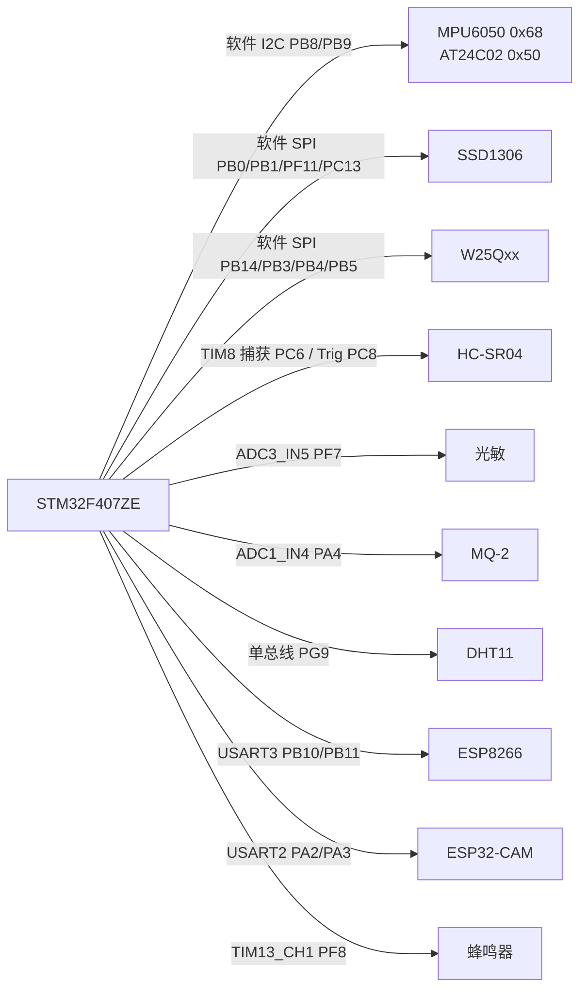

# 硬件组成与接口

> 详细选型、接线核对与排错流程见 [HARDWARE_CHECKLIST.md](HARDWARE_CHECKLIST.md)。
> 本文给出硬件总览、引脚分配与供电 / 复用注意事项。

---

## 1. 硬件组成

| 类别 | 型号 / 规格 | 数量 | 说明 |
|---|---|---|---|
| 主控 | STM32F407ZE | 1 | Cortex-M4F，168 MHz，192 KB RAM，1 MB Flash |
| 显示屏 | SSD1306 0.96" OLED（8 脚 SPI，带 GT20L1616 字库） | 1 | 本地状态 / 告警 / 学习进度 |
| 温湿度 | DHT11 | 1 | 单总线 |
| 烟雾 | MQ-2 | 1 | 模拟输出，需 5 V 供电与预热 |
| 光照 | 光敏电阻（板载） | 1 | 分压后接 ADC |
| 测距 | HC-SR04 | 1 | 5 V 供电，Trig / Echo |
| 姿态 | MPU6050（GY-521） | 1 | 防拆 / 震动 |
| 存储 | AT24C02（256 B EEPROM） | 1 | 配置掉电保存 |
| 存储 | W25Qxx SPI Flash | 1 | 告警事件环形日志 |
| 无线 | ESP8266（ESP-12F） | 1 | WiFi + MQTT |
| 视觉 | ESP32-CAM | 1 | 抓拍 + HTTP 图片 / 视频流 |
| 人机 | 板载按键 S1~S4、LED D0~D3、无源蜂鸣器 | 各 1 组 | 模式切换、告警指示与声音 |
| 时钟 | LSE 32.768 kHz + VBAT 纽扣电池 | 1 | RTC 走时 |
| 调试 | J-Link（SWD） | 1 | 下载与调试 |

---

## 2. 引脚分配

### 2.1 传感器与执行器

| 模块 | 信号 | STM32 引脚 | 外设 / 模式 | 备注 |
|---|---|---|---|---|
| 光敏电阻 | AO | PF7 | ADC3_IN5 | 光照越强 ADC 越小 |
| MQ-2 | AO | PA4 | ADC1_IN4 | 与电位器共用 ADC1；需 5 V 供电 |
| DHT11 | DATA | PG9 | GPIO 单总线 | 需上拉；读取间隔 ≥ 1.5 s |
| HC-SR04 | TRIG | PC8 | GPIO 推挽输出 | 15 ?s 触发脉冲 |
| HC-SR04 | ECHO | PC6 | TIM8_CH1 输入捕获 | 1 MHz 计数，1 tick = 1 ?s |
| MPU6050 | SCL / SDA | PB8 / PB9 | 软件 I2C | 地址 0x68 |
| AT24C02 | SCL / SDA | PB8 / PB9 | 软件 I2C | 地址 0x50，与 MPU6050 共总线 |
| 蜂鸣器 | PWM | PF8 | TIM13_CH1 | 无源，PWM 驱动 |
| LED0~LED3 | — | PF9 / PF10 / PE13 / PE14 | GPIO | 低电平点亮 |

### 2.2 显示与存储

| 模块 | 信号 | STM32 引脚 | 备注 |
|---|---|---|---|
| OLED | SCLK | PB0 | 软件 SPI |
| OLED | DC | PB1 | 命令 / 数据选择 |
| OLED | MOSI | PF11 | 软件 SPI（非硬件 SPI 复用） |
| OLED | CS1 | PC13 | 与 RTC Tamper 共用，RTC 初始化时禁用 Tamper |
| OLED | CS2 | VCC | **必须接 VCC**，禁用板载字库芯片 |
| OLED | FSO | 悬空 | 字库输出，不用 |
| W25Qxx | CS | PB14 | 软件 SPI |
| W25Qxx | SCK | PB3 | JTDO，调试器需 SWD 模式 |
| W25Qxx | MISO | PB4 | JTRST，调试器需 SWD 模式 |
| W25Qxx | MOSI | PB5 | 软件 SPI |

### 2.3 串口与按键

| 接口 | 信号 | 引脚 | 波特率 | 用途 |
|---|---|---|---|---|
| USART1 | TX / RX | PA9 / PA10 | 115200 | 调试日志 |
| USART2 | TX / RX | PA2 / PA3 | 115200 | ESP32-CAM |
| USART3 | TX / RX | PB10 / PB11 | 115200 | ESP8266 AT |
| 按键 S1 | — | PA0 | — | HOME |
| 按键 S2 | — | PE2 | — | AWAY |
| 按键 S3 | — | PE3 | — | 短按 SLEEP / 长按 2 s 重学基线 |
| 按键 S4 | — | PE4 | — | 短按手动告警 / 长按 1.5 s 回放事件日志 |

> 四个按键均为**低电平有效**（内部上拉）。课程模板注释称 PA0 为高有效，与本板实测不符。

---

## 3. 总线拓扑

---

## 4. 供电与电气注意

| 项 | 要求 |
|---|---|
| STM32 / OLED / 传感器逻辑 | 3.3 V |
| OLED VCC | 模块推荐 5 V（3.3 V 也可工作，视模块而定） |
| MQ-2 | **5 V**，需要预热；ADC 输出不超过 3.3 V |
| HC-SR04 | **5 V**，3.3 V 供电无回波 |
| ESP8266 | 3.3 V，峰值电流可达 300 mA，需独立或低阻抗供电 |
| ESP32-CAM | **5 V / ≥ 500 mA**，与 STM32 分开供电可降低复位风险 |
| 共地 | 所有模块必须与 STM32 共地 |
| J-Link | 仅在 SWD 模式下使用；PB3/PB4 为 JTAG 复用脚 |

---

## 5. 引脚复用与冲突

| 冲突 | 说明 | 处理 |
|---|---|---|
| PC13：OLED_CS vs RTC Tamper | RTC 初始化若启用 Tamper 会占用 PC13 | `rtc.c` 中禁用 Tamper；RTC 在 OLED 之后初始化 |
| PF9：LED0 vs TIM14_CH1 | 同一引脚两种用途 | 以当前 LED / PWM 初始化顺序为准，不可同时使用 |
| PE14：LED3 vs TIM1_CH4 | 同上 | 同上 |
| PA4：MQ-2 vs 4×4 键盘 COL2 | 矩阵键盘已弃用 | 键盘驱动已移除 |
| PB3/PB4：SPI Flash vs JTAG | 调试器必须用 SWD | J-Link 配置为 SWD |
| PB8/PB9：MPU6050 vs AT24C02 | 共用软件 I2C | FreeRTOS 下用 `s_i2c_mutex` 串行化 |
| LED 编号 | `led.c` 的 case 为 1-based，`led.h` 宏为 0-based | `LED_ON(1)`=PF9、`(2)`=PF10、`(3)`=PE13、`(4)`=PE14；`LED_ON(0)` 为空操作 |

---

## 6. 上电与调试要点

1. **OLED 黑屏**：先确认 CS2 接 VCC、PC13 未被 RTC Tamper 占用、软件 SPI 时序使用 `delay_us(1)`；
2. **ESP8266 无 AT 响应**：优先重新插拔模块与检查 CH_PD / 供电，再怀疑模块损坏；
3. **MPU6050 原始值恒为 0**：多次 J-Link 烧录后可能停留在睡眠模式，**彻底断电重上电**可恢复；
4. **DWT 时基异常**：反复烧录后 DWT 可能失效，`delay.c` 已提供 SysTick 后备时基；
5. **调试 halt 触发 IWDG 复位**：J-Link halt 会冻结 CPU 但 IWDG 继续计时，属正常现象，不是固件复位。

---

## 7. 未接入 / 已移除的硬件

| 硬件 | 状态 | 原因 |
|---|---|---|
| SG90 舵机 | 未接，驱动已移除 | 与当前功能无关 |
| 4×4 矩阵键盘 | 弃用并移除 | COL2 与 MQ-2 抢 PA4 |
| OV7670 / 人脸识别模块 | 未接入 | 视觉功能由 ESP32-CAM 承担 |
