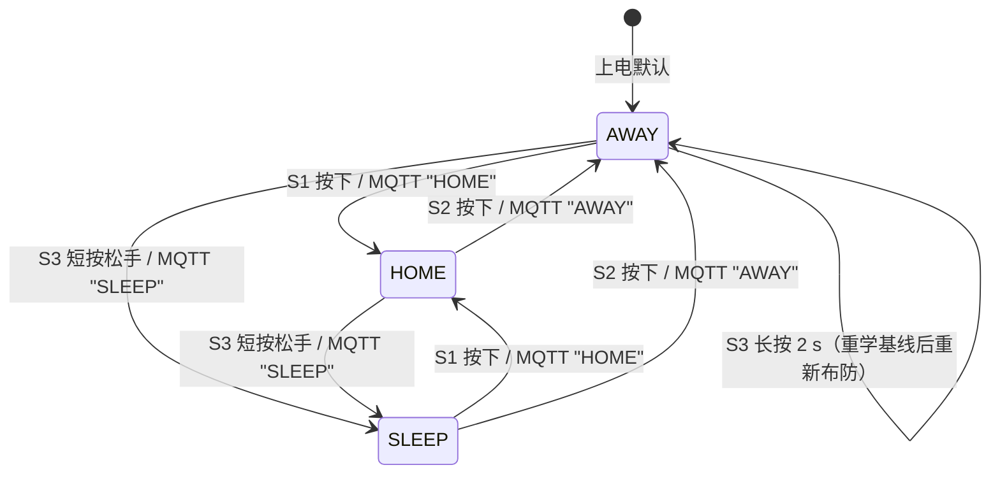
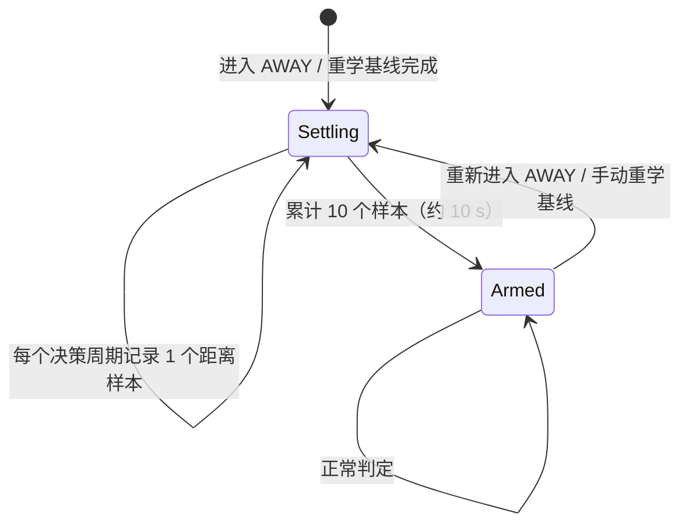
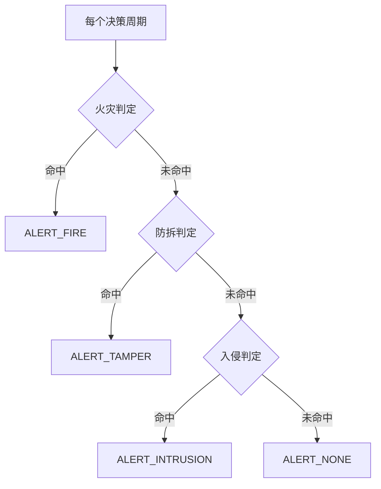
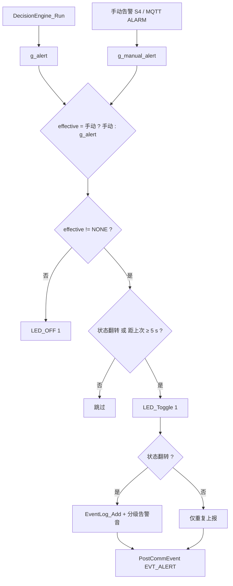
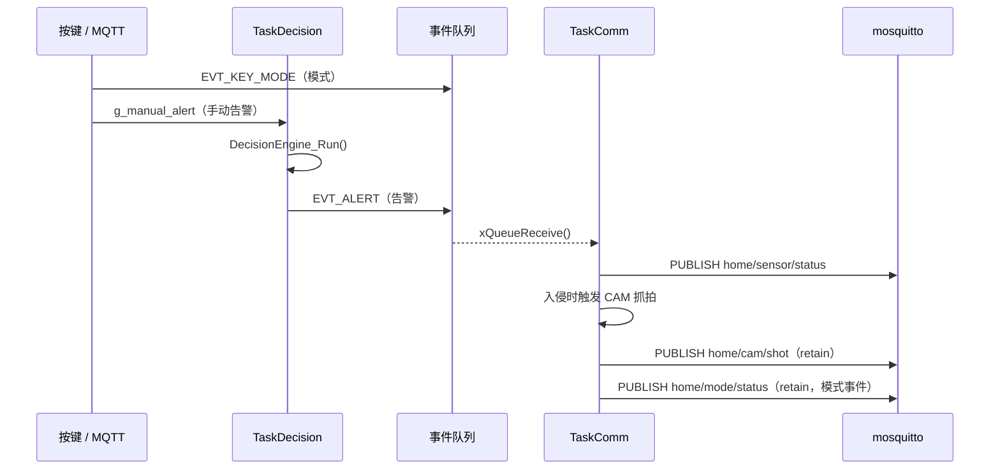

# 状态机与事件驱动

> 代码位置：`Hardware/APP/decision_engine.c`（模式机、告警仲裁、布防子状态）、`User/main.c`（按键 / MQTT 事件入口、告警统一出口）。

---

## 1. 守护模式状态机

### 1.1 状态定义

| 状态 | 枚举 | 语义 | 入侵 | 防拆 | 照明 | 火灾 |
|---|---|---|---|---|---|---|
| HOME | `MODE_HOME` | 主人在家 | 关闭 | 关闭 | 自动 | 开启 |
| AWAY | `MODE_AWAY` | 离家布防 | 开启 | 开启 | 自动 | 开启 |
| SLEEP | `MODE_SLEEP` | 在家睡眠 | 关闭 | 开启 | 关闭 | 开启 |

### 1.2 迁移条件

| 触发源 | 事件 | 处理 |
|---|---|---|
| 板载按键 S1 | 按下 | `g_mode = MODE_HOME`，`DecisionEngine_SetMode()`，置配置脏标志 |
| 板载按键 S2 | 按下 | `g_mode = MODE_AWAY`，重启布防静息采样，置配置脏标志 |
| 板载按键 S3 | 短按（松手 < 2 s） | `g_mode = MODE_SLEEP`，置配置脏标志 |
| 板载按键 S3 | 长按 ≥ 2 s | `g_relearn_request = 1`，由 `TaskDecision` 执行 20 s 重学 |
| MQTT | `"HOME"` / `"AWAY"` / `"SLEEP"` | 更新模式并合并上报；**不置配置脏标志** |
| 上电 | `Config_Load()` 成功 | 恢复 EEPROM 中的模式 |
| 上电 | `Config_Load()` 失败 | 保持默认 AWAY，重新学习基线后保存 |

> **模式持久化的实际行为**：只有板载按键切换会置 `s_config_dirty`，由 `TaskDisplay` 在 1 s 内写入 AT24C02。通过 MQTT 远程切换的模式**不会立即落盘**，掉电后会回到最后一次按键保存的模式。这是当前实现的限制，不是设计目标。

### 1.3 进入 AWAY 的副作用

`DecisionEngine_SetMode(MODE_AWAY)` 会：

1. 清空告警状态（`s_alert_last = ALERT_NONE`）；
2. 关闭蜂鸣器、熄灭告警 LED；
3. 进入布防静息采样子状态（见下一节），给操作者约 10 s 撤离时间；
4. 串口打印 `[ARM] AWAY armed: 10s settling, please leave...`。

---

## 2. 布防静息采样子状态机

旧实现用固定 `< 40 cm` 作为入侵硬阈值，设备放进纸箱（箱壁 20~40 cm）或紧贴墙面时会持续误报。当前实现改为**先学习静息距离，再判断是否逼近**。

| 参数 | 值 | 位置 |
|---|---|---|
| 采样个数 | `ARM_SAMPLE_N = 10` | `decision_engine.c` |
| 采样周期 | 1 s（`TaskDecision`） | `main.c` |
| 静息距离 | 10 个样本的**中位数** `s_dist_rest` | `arm_median()` |
| 逼近判定 | `distance + 15 cm < s_dist_rest` 且 `distance < 120 cm` | `ARM_APPROACH_CM` / `INTRUSION_DIST_SOFT` |
| 静息无效兜底 | `distance < 40 cm` | `INTRUSION_DIST_HARD` |

- 采样期只记录，不判定入侵；
- 中位数抗瞬间遮挡（例如撤离时手臂扫过）；
- 重学基线、重新进入 AWAY 都会重启采样；
- 静息采样期间串口输出 `[ARM] settling n/10 dist=..cm`，完成后输出 `[ARM] armed OK, rest=..cm, alarm when closer than ..cm`。

---

## 3. 告警判定与仲裁

### 3.1 三类告警

| 告警 | 枚举 | 判据 | 代码 |
|---|---|---|---|
| 火灾 | `ALERT_FIRE` | 烟雾 ≥ 自适应阈值 + 60 且温度异常，连续 4 个样本 | `AT_CheckFire()` |
| 防拆 | `ALERT_TAMPER` | MPU6050 滑动窗口命中 ≥ 3 次 | `TamperUpdate()` + `CheckTamper()` |
| 入侵 | `ALERT_INTRUSION` | 逼近静息距离 / ≤ 8 cm 直通 / 距离突变 > 20 cm / ML 辅助 | `CheckIntrusion()` |

### 3.2 优先级仲裁

三项判定**全部求值**后再按 **火灾 > 防拆 > 入侵** 选择，而不是短路串联。原因：摇晃设备时 HC-SR04 读数剧烈变化可能先被判为入侵，若短路就会导致防拆告警永远不执行。

### 3.3 入侵判定的连续确认

| 条件 | 动作 |
|---|---|
| 距离 ≤ 8 cm | 当周期立即告警（`s_intrusion_hit = 0`） |
| 规则 / ML 命中 | `s_intrusion_hit++`（上限 5） |
| 距离 > 120 cm | `s_intrusion_hit--` |
| 距离 40~120 cm 且未命中 | 计数保持不变（避免 ML 偶发误判打断累积） |
| 无效距离（≤ 0） | 计数衰减，返回无告警 |
| `s_intrusion_hit >= 2` | 触发告警并清零，下次重新累积 |

因此典型延迟为 1~2 个决策周期（1~2 s），叠加采样与调度抖动后实测约 2~4 s。

---

## 4. 告警状态与本地执行

`User/main.c` 的 `task_decision()` 是告警的**统一出口**：

| 行为 | 触发条件 | 说明 |
|---|---|---|
| LED 翻转 | 告警存在且（状态翻转或 5 s 冷却到期） | 告警灯 PF9 闪烁 |
| 蜂鸣器 | **仅状态翻转** 且 `BEEP_ENABLE=1` | 入侵三连音 / 火灾双音 / 防拆长音 / 环境异常短音 |
| 事件日志 | **仅状态翻转** | 16 B 记录写入 W25Qxx，5 s 重复告警不重复落盘 |
| MQTT 上报 | 状态翻转或每 5 s | 告警持续存在时每 5 s 重发一次 |
| CAM 抓拍 | 入侵告警事件 | 由 `TaskComm` 执行，URL 以 retain 发布 |
| OLED 告警页 | `g_alert != ALERT_NONE` | `TaskDisplay` 每 500 ms 刷新 |

告警音时长最长约 1.2 s，小于 IWDG 2 s 窗口，且只在状态翻转时播放。

---

## 5. 事件驱动链路

| 事件 | 生产者 | 消费者 | 语义 |
|---|---|---|---|
| `EVT_KEY_MODE` | `TaskFast`（按键） | `TaskComm` | 物理按键切换模式后补报 retain |
| `EVT_ALERT` | `TaskDecision` | `TaskComm` | 告警上报；入侵时抓拍 |
| MQTT 下行 | `TaskComm` | `MQTT_OnCmdReceived()` | 灯控 / 模式 / `CAPTURE` / `ALARM` |

---

## 6. 异常与边界行为

| 场景 | 行为 |
|---|---|
| 基线未学习完成 | `TaskDecision` 只采样，不决策、不上报 |
| DHT11 读取失败 | 保留上次有效温湿度，不归零 |
| HC-SR04 超时 / 无效值 | 返回 0，入侵判定直接放过并衰减命中计数 |
| MQ-2 基线 > 2000 | 判定传感器未接入，火灾阈值设为 `0xFFFF` 禁用 |
| MQ-2 后续恢复正常 | 连续 60 个样本正常后重建阈值并置脏落盘 |
| MPU6050 初始化失败 | 防拆判定不生效，其他功能继续 |
| 事件队列满 | 丢弃事件；告警靠 5 s 冷却重发，模式靠 retain 最终一致 |
| HOME 模式下检测到震动 | 主动抑制并打印 `[TAMPER] suppressed by MODE_HOME` |
| SLEEP 模式下距离变化 | 不判入侵（起夜不误报），防拆仍生效 |

---

## 7. 已知限制

- 远程 MQTT 切换模式不落盘（见 1.2 节）；
- 火灾检测不受模式门控，任何模式都会告警；
- 温度判据在本板因 DHT11 长期恒定而退化，实际是烟雾单判据；
- 告警状态只有"有 / 无"两态，没有独立的"告警中 / 已确认 / 已恢复"生命周期；
- 手动告警 `g_manual_alert` 是单槽覆盖，连续触发时后一次覆盖前一次（配合 5 s 冷却可接受）。
